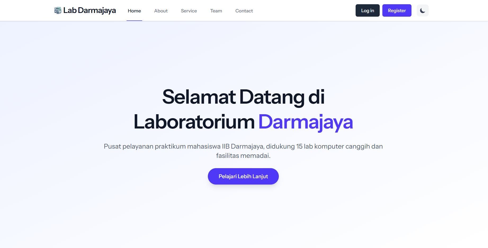
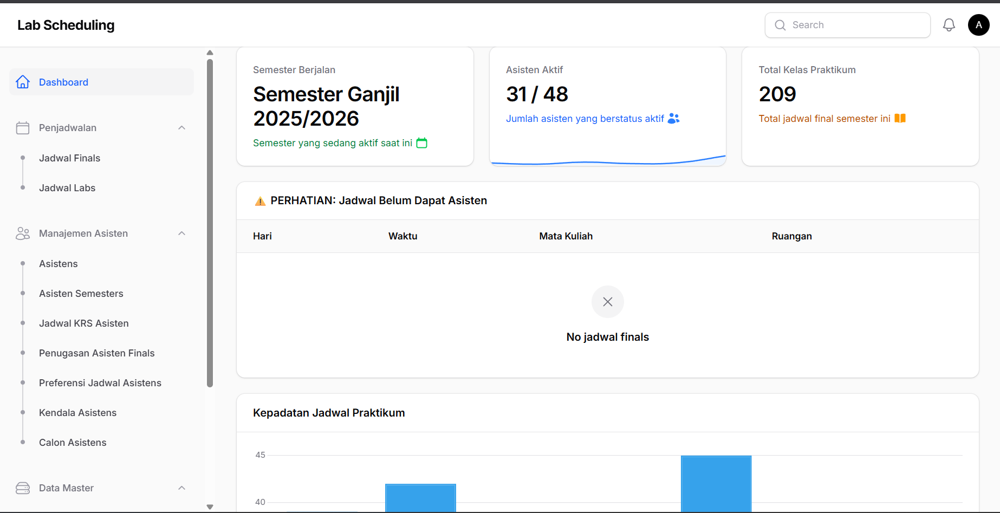
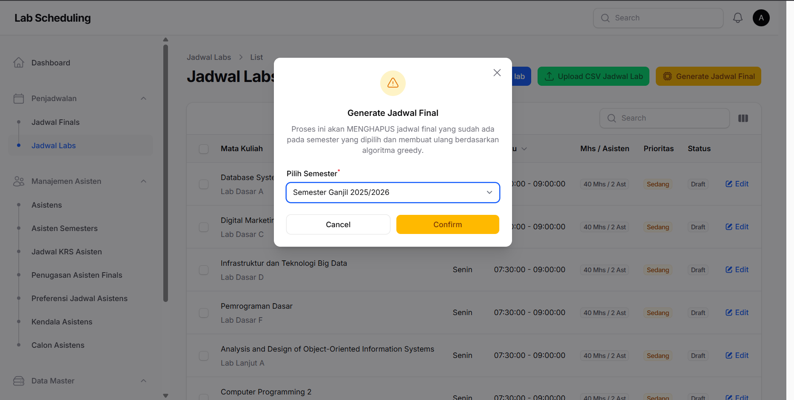
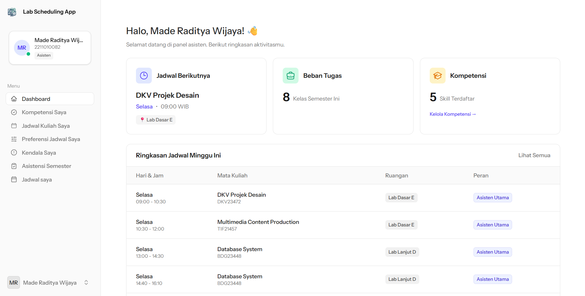

# 🧪 Lab Scheduling App - IIB Darmajaya


Sistem Informasi Penjadwalan Asisten Laboratorium untuk IIB Darmajaya. Aplikasi ini dirancang untuk mengotomatisasi penugasan asisten laboratorium pada jadwal praktikum menggunakan **Algoritma Greedy**, meminimalisir bentrok jadwal, dan mempermudah manajemen data laboratorium.

---

## 📸 Preview Aplikasi

<details open>
<summary><b>Klik untuk melihat/menyembunyikan screenshot</b></summary>
<br>

| Halaman Utama (Landing Page) | Dashboard Admin (Filament) |
| :---: | :---: |
|  |  |
| **Generate Jadwal (Algoritma Greedy)** | **Dashboard Asisten (User Panel)** |
|  |  |

</details>

---

## ✨ Fitur Utama

### 👨‍💼 Panel Admin (Koordinator Lab)
- **Dashboard Analitik**: Pantau statistik asisten, semester aktif, dan grafik kepadatan jadwal.
- **Manajemen Data Master**: Kelola data Asisten, Mata Kuliah, Ruangan, dan Kompetensi.
- **Import CSV Massal**: Upload data Asisten, Mata Kuliah, dan Jadwal Praktikum secara instan.
- **Auto-Scheduling (Greedy)**: Generate jadwal asisten secara otomatis berdasarkan kompetensi, preferensi, dan ketersediaan waktu.
- **Manajemen Penugasan**: Verifikasi kualifikasi asisten dan sesuaikan penugasan secara manual jika diperlukan.

### 🎓 Panel Asisten (User)
- **Dashboard Personal**: Lihat ringkasan jadwal dan rata-rata skor kecocokan.
- **Manajemen Kualifikasi**: Kelola kompetensi dan sertifikasi mata kuliah.
- **Input Preferensi & Kendala**: Atur jadwal preferensi mengajar dan laporkan kendala waktu (halangan pribadi).
- **Jadwal Saya**: Lihat jadwal praktikum final yang telah ditugaskan.
- **Dark/Light Mode**: Tema antarmuka yang tersinkronisasi otomatis dengan sistem.

## ⚙️ Teknologi yang Digunakan
- **Framework**: Laravel 12
- **Admin Panel**: FilamentPHP v3
- **Frontend User**: Livewire v3 + Alpine.js
- **Styling**: Tailwind CSS + Flux UI Components
- **Database**: MySQL / MariaDB
- **Algoritma**: Greedy Algorithm (Untuk Penjadwalan)

## 🚀 Panduan Instalasi (Development)

Ikuti langkah-langkah berikut untuk menjalankan aplikasi di lingkungan lokal:

### Persyaratan Sistem
- PHP >= 8.1
- Composer
- Node.js & NPM
- MySQL / MariaDB

### Langkah Instalasi

1. **Clone Repository**
   ```bash
   git clone [https://github.com/MadeRaditya/lab-scheduling-app.git](https://github.com/MadeRaditya/lab-scheduling-app.git)
   cd lab-scheduling-app
   ```

2.  **Install Dependensi PHP & Node.js**

    ```bash
    composer install
    npm install
    ```

3.  **Konfigurasi Environment**
    Copy file `.env.example` menjadi `.env` dan atur koneksi database Anda.

    ```bash
    cp .env.example .env
    ```

    *Edit file `.env` dan sesuaikan `DB_DATABASE`, `DB_USERNAME`, `DB_PASSWORD`.*

4.  **Generate App Key & Setup Storage**

    ```bash
    php artisan key:generate
    php artisan storage:link
    ```

5.  **Migrasi Database & Seeder**
    Pastikan database sudah dibuat di MySQL, lalu jalankan:

    ```bash
    php artisan migrate:fresh --seed
    ```

6.  **Build Asset & Jalankan Server**
    Buka dua terminal terpisah dan jalankan:

    ```bash
    npm run dev
    ```

    ```bash
    php artisan serve
    ```

## 🔐 Akses Login Default

Setelah seeder dijalankan, Anda bisa login menggunakan kredensial berikut:

  - **Admin / Koordinator Lab:**

      - URL: `http://localhost:8000/admin`
      - Email: `admin@mail.com`
      - Password: `admin1234`

  - **Asisten Lab (Contoh):**

      - URL: `http://localhost:8000/login`
      - Login menggunakan email/password dari data dummy yang di-*generate* oleh seeder, atau gunakan fitur *Register* untuk membuat asisten baru.

## 🧠 Tentang Algoritma Greedy

Aplikasi ini mengimplementasikan Algoritma *Greedy* pada layanan `GreedyScheduler`. Algoritma bekerja dengan cara:

1.  Menyortir slot jadwal praktikum yang kosong.
2.  Memfilter kandidat asisten berdasarkan kualifikasi mata kuliah (Validasi).
3.  Mengecek *Personal Conflict* (Jadwal kuliah/halangan asisten) dan *Time Overlap* (Bentrok antar tugas).
4.  Memberikan pembobotan (*Scoring*) berdasarkan preferensi jadwal yang diinputkan asisten.
5.  Memilih asisten dengan skor tertinggi (*Greedy Choice*) untuk ditugaskan ke slot tersebut.

## 📄 Lisensi

Proyek ini dilisensikan di bawah MIT License - lihat file [LICENSE](LICENSE) untuk detail.

-----

*Dibuat untuk keperluan Tugas Akhir / Skripsi di IIB Darmajaya.*
